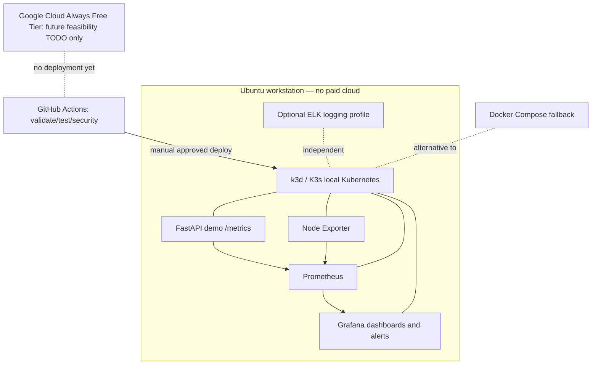

# Target Architecture — Local Kubernetes First

**Status: PROPOSED, not deployed.** Existing `master` runs Docker Compose definitions only; the Helm/K8s artifacts below are future deliverables.

## Deployment targets

| Target | Role | Cost policy | Status |
|---|---|---|---|
| k3d/K3s + Helm on Ubuntu | Primary portfolio demonstration | Local, no cloud charges | PLANNED |
| Docker Compose | Developer fallback and baseline comparison | Local | Existing definition; runtime NOT_RUN |
| Google Cloud Always Free | Optional cloud learning experiment (not full GKE/ELK promise) | Strictly free-tier eligible resources; verify quotas and billing before use | TODO / NOT_RUN |

## Kubernetes boundaries

- Namespace `observability`; isolated demo workload and separate optional logging namespace.
- Helm deployment(s) with version-pinned images, resource requests/limits, readiness/liveness probes, and bounded persistence.
- Kubernetes Secrets from local ignored inputs, never hardcoded in tracked files.
- No public Grafana, Prometheus, Elasticsearch or exporters by default; local port-forward for viewing.
- Use K8s Services for internal discovery, no open ingress by default; restrictive NetworkPolicies where supported.
- Prefer chart-defined exporter deployment topology compatible with local k3d nodes, rather than assuming the host OS is a cluster node.
- Minimize ELK resources through optional installation and teardown; validate version compatibility separately.

## CI and acceptance evidence

- Static: YAML syntax, Compose config, Helm lint/template, Kubernetes schema validation, dependency/image security scans.
- Integration: create local test cluster (as supported), deploy exact source snapshot, wait for rollout, verify Prometheus scrape targets, Grafana datasource, and an ingested sample log when ELK is selected.
- Release proof: commit SHA, dependency versions, run URL, commands, stdout/stderr excerpts, and PASS/FAIL/NOT_RUN matrix.
- Cloud: **not** an acceptance dependency. If later requested, an explicit manual gate and budget/quota review precede any provision; a budget alert is not a hard cost cap.

## Decisions

- [ADR-0001 — Local Kubernetes as primary](adr/0001-local-kubernetes-first.md)
- [ADR-0002 — Optional logging stack](adr/0002-optional-logging-stack.md)
- [ADR-0003 — GCP Always Free research-only](adr/0003-gcp-always-free-todo.md)
